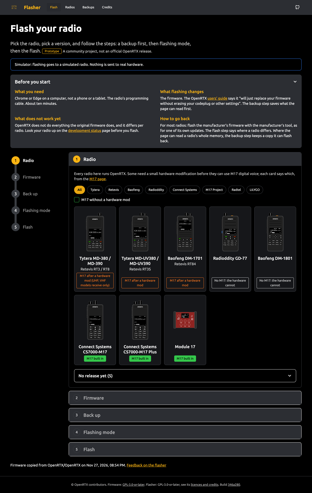

# OpenRTX site and web flasher

One static site with two parts:

- **The flasher**, a page that puts [OpenRTX](https://openrtx.org) on a radio: pick the
  radio, pick a firmware build, follow the steps. Where the browser can talk to the radio
  it backs it up and flashes it directly; everywhere else it hands over the right file
  and the command for the usual tool. It has a command-line twin.
- **The OpenRTX pages and docs**: the users' guide, the hardware pages, the developers'
  docs and the news, with search, a sidebar and an "Edit page" link on every page.
  [The site, and who writes its pages](#the-site-and-who-writes-its-pages) says where
  they come from.

This is a community prototype, not an official OpenRTX release. Before the page talks
to a radio model nobody has checked on real hardware, it asks once to turn experimental
flashing on (see [docs/qa.md](docs/qa.md)). The Retevis C62 and the Connect Systems
CS7000-M17 are checked so far; [docs/verification.md](docs/verification.md) has the
record.

More: [choosing firmware](docs/screenshots/2-firmware.png),
[after a backup](docs/screenshots/3-backed-up.png),
[entering flashing mode](docs/screenshots/4-flashing-mode.png),
[after flashing](docs/screenshots/5-flashed.png).

## What it does

| Radio                                                  | In the browser                             | Otherwise                |
| ------------------------------------------------------ | ------------------------------------------ | ------------------------ |
| MD-380 / MD-390, MD-UV380 / MD-UV390, MD-9600, DM-1701 | WebUSB, TYT bootloader                     | radio_tool               |
| GD-77, DM-1801                                         | WebHID                                     | gd-77_firmware_loader.py |
| Module 17, CS7000-M17, CS7000-M17 Plus                 | WebUSB, STM32 DFU                          | dfu-util                 |
| Radtel RT-4D                                           | Web Serial                                 | RT-4D-python-flasher     |
| Radtel RT-950 Pro                                      | Web Serial, Radtel's bootloader            | rt950_flash.py           |
| Retevis C62 / C2                                       | Web Serial, cskburn as WebAssembly         | cskburn                  |
| T-TWR Plus                                             | — (download the UF2, copy it to the drive) | file manager             |

Radios with a file in the current OpenRTX release are listed first. The others (today
the MD-9600, RT-4D, RT-950 Pro, T-TWR Plus and C62) are in a second list, "No release
yet", folded until asked for; they take a development build or a file you bring. The
RT-950 Pro has no OpenRTX build upstream yet: its port is on a
[branch](https://github.com/Marko13-dev/OpenRTX/tree/rt950pro), and the page takes the
`.BTF` that branch builds.

The page is five steps, one open at a time; a finished step folds to its bar and opens
again from there. Radio and Firmware come first, then Back up, Flashing mode and Flash
in the order they happen for the chosen radio.

Firmware is one of three choices:

- **Current release** and **Development build** (the latest master build). Both are
  copied into the site when it is built.
- **Other**: a past release; any branch, pull request or fork that uses OpenRTX's GitHub
  workflow (the page finds the CI build and links the zip, you download it and drop it
  on the page); or a file from your computer.

The backup step reads what the page can read from the radio, or is skipped. Only the C62
and Module 17 are backed up whole. On every other radio at least one memory is not
saved, or only in part. Each of those is a critical gap, and the step names it before the
read. [docs/backup-coverage.md](docs/backup-coverage.md) has every radio memory by
memory, and [docs/dumper.md](docs/dumper.md) the plan for closing the gaps.

- **C62, Module 17**: in flashing mode the page reads the whole flash. That backup can be
  flashed back from the page.
- **CS7000, CS7000 Plus**: in flashing mode the page reads the whole program memory, and
  can flash it back. The memory chip beside the processor is not read. It holds the
  factory calibration, and OpenRTX erases a part of that chip the first time it starts.
  A CS7000 Plus with its Connect Systems firmware refuses the read altogether.
- **MD-380, MD-UV380, MD-9600, DM-1701, GD-77, DM-1801, RT-4D, RT-950 Pro**: their
  bootloaders cannot be read, so the page reads the radio through its original firmware,
  in normal mode, before you put it in flashing mode. It only reads, and the page cannot
  write this backup back. A radio that already runs OpenRTX cannot be read this way at
  all. What the read gives:
  - MD-380, MD-UV380, MD-9600, DM-1701: the factory info blocks, the first 64 KB of the
    program memory (the bootloader; 4 KB on Linux) and the whole 16 MB memory chip. Not
    the firmware, which is the other 960 KB, and not the chip's security registers,
    where the calibration is stored; the backup has the firmware's own copy of it.
  - GD-77, DM-1801: most of the 64 KB EEPROM and about 60 KB of the 1 MB memory chip,
    which is the codeplug, and the calibration where the firmware gives it. Nothing of
    the program memory.
  - RT-4D: the whole 16 MB memory chip, in about half an hour. Nothing of the program
    memory.
  - RT-950 Pro: the first 64 KB of the 4 MB memory chip, which is as far as its
    programming cable reaches. Nothing of the program memory; the step links Radtel's
    firmware downloads. A full backup is in progress on a branch.
- **T-TWR Plus**: the drive holds the firmware as `CURRENT.UF2`, for you to copy. That
  is the firmware only: not the bootloader, the settings area or the rest of the flash.

The C62 takes two images from a build: the application (`zephyr.bin`) and the DSP image
(`dsp_firmware.bin`, written at 0x100000). The page writes both in one run. A build with
only the application is flashed with a warning, because OpenRTX does not start without
its DSP image.

A backup is one zip, `backup_<radio>_<end of its ID>_<date>.zip`: the pieces that were
read and `backup.json`, which says what each piece is, where it came from and its
SHA-256. The page downloads it and keeps a second copy in the browser; the Backups
section at the bottom lists them for every model, to save again, restore or forget. The
copy in the browser is a convenience: it goes when site data is cleared and does not
follow you to another computer. A backup is specific to one radio; keep it private.
Where the radio can say who it is before it is written (the chip ID of a C62, the USB
serial number of an STM32 radio), a backup of another radio is refused. A backup of a
simulated radio says so in `backup.json` and is only written to a simulated radio.

The backup step starts by finding out which radio is connected. When this browser
already holds a complete backup of that radio, the page says so and does not read it
again; a new one can still be taken on request. The radio is told apart by its chip ID
(C62), its unique ID (TYT radios), its USB serial number (STM32 radios) or a fingerprint
of its calibration (RT-4D, RT-950 Pro). The GD-77 and DM-1801 give theirs only at the end of their
one-minute read, so they are read each time.

The page calls a radio's two states flashing mode and normal mode, whatever its maker
calls them.

While the page reads or writes a radio it shows a moving bar, what it is doing with
amounts and a clock (a C62 backup is about ten minutes), the radio's last message, and a
console that can be opened to follow every step.

After a flash the page asks whether the radio started OpenRTX, and a failed flash or
backup offers "Report this". Either opens the project's issue tracker with a report
filled in (radio model, firmware, browser, the page's build, the end of the log) for the
person to read and send; a "Copy report" button gives the same text to take elsewhere.
The page sends nothing by itself, and a report holds no radio ID and nothing out of a
backup. Once a radio is marked as checked on hardware the page stops asking for
successes and only offers to report a problem.

In-browser flashing needs Chrome or Edge on a computer. Firefox and Safari get the
downloads and instructions.

## From a terminal

The same steps without a browser, run straight from this repository. Nothing is
published to npm:

    npx github:turnrye/openrtx-web-flasher radios
    npx github:turnrye/openrtx-web-flasher backup c62 --port /dev/ttyUSB0
    npx github:turnrye/openrtx-web-flasher flash c62 588 --port /dev/ttyUSB0

npm 12 does not fetch git addresses unless told to: `npx --allow-git=all github:…`.
The first run takes a little longer, because npm builds the program from the source.

| Command                    | What it does                                         |
| -------------------------- | ---------------------------------------------------- |
| `radios [radio]`           | the radios, or what one of them needs                |
| `firmware`                 | the releases and the development build               |
| `fetch <radio> <firmware>` | saves a radio's firmware files                       |
| `backup <radio>`           | reads the radio into a backup zip, the page's format |
| `flash <radio> <firmware>` | writes firmware, or a backup zip, to the radio       |
| `ports`                    | the serial ports, for `--port` (RT-4D, RT-950, C62)  |

`<firmware>` is `release`, a past release (`v0.4.5`), `master` (the development build), a
pull request number, a branch, `owner:branch` for a fork, or a file: firmware, a CI zip,
or a backup zip to restore. Node is not held to a browser's rules, so all of it is
downloaded for you. Listing and release files need no login. GitHub gives CI builds to
logged-in users only: with `GITHUB_TOKEN` set they come from GitHub, without it through
nightly.link.

- It runs the page's flashers, readers, catalogue and backup format, and keeps its
  safeguards. It asks before it writes (`--yes` skips that), and a radio in the wrong
  mode or a file for another radio is refused before anything is sent.
- **Checked on two real radios so far: the CS7000-M17 Plus and the MD-9600.** The radios
  marked as checked on the page were checked from Chrome; the command line reaches them
  through other USB, serial and HID libraries. So every other radio asks for
  `--experimental` until someone runs the bench check with it.
- `backup` stops early when `--out` already holds a backup of the radio that is
  connected, as the page does; `--again` reads it anyway.
- `--sim` runs any command against the simulated radios, as `?sim=1` does on the page.
- The C62 runs LISTENAI's own release of cskburn, the same commit the page compiles to
  WebAssembly. It is downloaded once and checked against `vendor.json`; `--cskburn`
  names another one. There are builds for Linux and macOS (x64, arm64) and Windows x64.
- On Windows a USB radio needs the WinUSB driver (Zadig); on Linux, udev rules that let
  you open the device.

## Develop

    npm ci
    npm run vendor      # fetch and build the pinned third-party parts, and the site's pages (see below)
    npm run mirror      # copy firmware from GitHub into public/firmware (optional)
    npm run dev         # http://localhost:4321, the flasher is at /flash/; add ?sim=1 for simulated radios
    npm run check       # format, lint, types and unit tests: what CI enforces
    SITE_BASE=/sub/path/ npm run build && npm run e2e    # browser tests against the built site
    npm run cli -- radios           # the command line, as `npm ci` last built it

The site is built by [Astro](https://astro.build) with
[Starlight](https://starlight.astro.build) (`astro.config.ts`); the flasher is a Preact
app on one of its pages. Components come from [daisyUI](https://daisyui.com) on Tailwind
CSS, themed once in `site/styles/theme.css` with the OpenRTX palette, so the pages and
the flasher look like one thing. Astro writes absolute links, so a build is made for the
path it will be served under (`SITE_BASE`; [docs/hosting.md](docs/hosting.md)).

`?sim=1` swaps real devices for simulated ones, so the whole flow can be tried without
a radio. `?sim=fail` simulates radios that do not answer, `?sim=protected` STM32 radios
that refuse to be read, `?sim=wrongmode` radios in the wrong state for what is asked,
`?sim=slow` radios that take their time, to watch the progress display and the console.

`ci/build.sh` is the whole pipeline and what both CI workflows run. A change is refused
when Prettier, ESLint (type-aware), stylelint, shellcheck, the TypeScript compiler, a
unit test or a browser test objects. `npm run format` fixes formatting.

## Third-party parts

Nothing from elsewhere is committed. `vendor.json` pins each piece to a commit and, for
single files, a SHA-256; `npm run vendor` fetches them, refuses anything that does not
match, and builds what needs building into `public/` (not in git):

- **cskburn** (LISTENAI, Apache-2.0), compiled to WebAssembly with a pinned Emscripten.
  The only code added is the serial layer in `tools/cskburn-wasm/`.
- **The device mock-ups** by Joshua Murphy (ranguli, VO1RFX), GPL-3.0: the CS7000 and
  MD-380 drawings. The other radios are drawn by `scripts/art.mjs` in the same manner.
- **The OpenRTX logo** and two **screenshots of the OpenRTX UI** for the drawings'
  screens.
- **shellcheck**, the one checker that is not an npm package.
- **The OpenRTX website's pages and pictures**, from
  [OpenRTX/openrtx.github.io](https://github.com/OpenRTX/openrtx.github.io) at a pinned
  commit, turned into pages of this site by `scripts/import-docs.mjs`. That repository
  states no licence yet, which is one reason they are fetched and not committed here.
- **cskburn as LISTENAI releases it**, for the command line. It is not part of the build:
  the command line downloads it into the cache the first time a C62 is flashed.

The command line's three device libraries (`usb`, `serialport`, `node-hid`) are optional
npm packages. The page does not use them, and a computer they cannot be installed on
still builds and tests everything.

Downloads are kept in a per-user cache, `~/.cache/openrtx-web-flasher` (or `$ORTX_CACHE`),
shared by every clone and worktree. Once a pin has been fetched, building needs no
network for it: the first cskburn build downloads Emscripten (about 1.8 GB unpacked),
later ones reuse the compiled result. The firmware mirror caches its downloads the same
way, retries, and falls back to the last good copy with a warning when GitHub cannot be
reached (`ci/test-mirror-cache.sh` checks that). CI restores the same cache between
runs. Deleting the cache only costs a download.

npm packages are pinned by `package-lock.json`, CI actions by commit. `vendor.json` also
records which upstream files the ported flashers were written from. To move a pin,
change it and run `npm run vendor -- --update`.

## Layout

    src/radios.ts        the radios: files, flashing mode, backup, fallback tool
    src/coverage.ts      what a backup holds of each radio, memory by memory, and the gaps
    src/firmware/        builds: bundled manifest, GitHub lookup, zips
    src/flash/           one flasher per bootloader protocol
    src/backup/          readers through the original firmware, the backup zip, the browser store
    src/feedback.ts      the report a user can send
    src/sim/             simulated radios, used by tests and ?sim=1
    src/ui/              the flasher's page
    astro.config.ts      the site: its base path, sidebar and theme
    site/content/docs/   the site's pages; .mdx are written here, .md are copied in at build time
    site/components/     the flasher's island, the licences tables
    site/styles/         the one stylesheet: Tailwind, daisyUI and the OpenRTX palette
    cli/                 the command line: devices, firmware and cskburn for Node
    tests/e2e/           browser tests against the simulated radios
    scripts/             vendor step, website import, drawings, firmware mirror, screenshots
    ci/                  build, test and publish scripts shared by both forges
    tools/cskburn-wasm/  the serial layer cskburn is compiled with
    docs/                hosting, QA, bench notes, the bench record, backup coverage; also published under /flasher/
    vendor.json          what comes from elsewhere, and at which version

## Hosting

The build is a folder of static files, made for the path it is served under. See
[docs/hosting.md](docs/hosting.md) for GitHub Pages, Forgejo with git-pages, and any
other static host.

## The site, and who writes its pages

The aim is one project for the OpenRTX website, its docs and the flasher. Until the
website's own repository is part of it, its pages are copied in at build time:

- `vendor.json` pins a commit of
  [OpenRTX/openrtx.github.io](https://github.com/OpenRTX/openrtx.github.io);
  `npm run vendor` checks it out and `scripts/import-docs.mjs` turns its docsify pages
  into `site/content/docs/*.md`. Those copies are not committed. To take newer pages,
  move the pin.
- Every page has an **Edit page** link. On a copied page it opens the file in the
  website's repository; on a page written here (`.mdx`), the file in this one.
- Addresses of the old site (`/#/user_guide?id=flashing…`) are sent on to the new page.
- People who do not want to edit a file use the form linked from the site's
  ["Help improve this site"](site/content/docs/contribute.mdx) page
  (`.github/ISSUE_TEMPLATE/docs-suggestion.yml`). Nothing here needs a server: a
  browser-based editor with its own sign-in would, and is left for the project to decide.

A page written here wins over a copied page with the same address, which is how a page
moves over: write it as `.mdx`, and the copy stops being made.

## Credits and licences

GPL-3.0-or-later. The published site lists what it ships and under which licence on its
"Licences and credits" page; the texts are in `LICENSES/`. `vendor.json` records the
upstream revision each port was written from.

Ported from or built on other people's work:

- TYT flasher: ported from [radio_tool](https://github.com/v0l/radio_tool) by v0l
  (GPL-3.0-or-later).
- GD-77 and DM-1801 flasher: ported from the GD-77 firmware uploader by Roger Clark
  VK3KYY, as carried in OpenRTX's `scripts/gd-77_firmware_loader.py` (GPL-2.0-or-later,
  used here under version 3 or later). Test files are built the way OpenRTX's
  `bin2sgl.py` by Kai Ludwig DG4KLU does (BSD-3-Clause).
- RT-4D flasher: ported from
  [RT-4D-python-flasher](https://github.com/fagci/RT-4D-python-flasher) by Mikhail Yudin
  (GPL-3.0).
- CS7000-M17 Plus robot mode (command line): the bootloader protocol and its table from
  imostlylurk's [cs7000plus_flasher](https://github.com/imostlylurk/cs7000plus_flasher)
  (Apache-2.0).
- RT-950 Pro flasher: follows the bootloader protocol in `scripts/rt950_flash.py` of
  Marko13's [RT-950 Pro port of OpenRTX](https://github.com/Marko13-dev/OpenRTX/tree/rt950pro)
  (GPL-3.0-or-later).
- USB DFU: written from the DFU 1.1 specification and ST's AN3156, with two ideas from
  [webdfu](https://github.com/devanlai/webdfu) (ISC).
- C62 flasher: [cskburn](https://github.com/LISTENAI/cskburn) by LISTENAI (Apache-2.0),
  compiled to WebAssembly unchanged, including its burner images.
- TYT backup: ported from [RadioFoundry](https://github.com/RadioFoundry/RadioFoundry)
  (MIT), which measured it on an MD-9600; codeplug ranges from
  [dmrconfig](https://github.com/sergev/dmrconfig) (BSD-3-Clause) and
  [qdmr](https://github.com/hmatuschek/qdmr) (GPL-3.0-or-later).
- GD-77 and DM-1801 backup: the programming protocol as dmrconfig and qdmr speak it.
- RT-4D backup: the read command of DualTachyon's
  [rt-4d-spiflash-cli](https://github.com/DualTachyon/rt-4d-spiflash-cli) (Apache-2.0).
- RT-950 Pro backup: ported from the read path of `cps_flash.py` in Hertzz58's
  [Radtel-RT950-Pro-Firmware](https://github.com/Hertzz58/Radtel-RT950-Pro-Firmware)
  (GPL-3.0).
- Radio drawings: [openrtx-device-mockups](https://github.com/ranguli/openrtx-device-mockups)
  by Joshua Murphy (GPL-3.0) for the CS7000 and MD-380; the rest follow his style.
- Ubuntu font (Ubuntu Font Licence 1.0). OpenRTX logo from the OpenRTX website.
- Colours from the OpenRTX UI toolkit's Standard theme.
